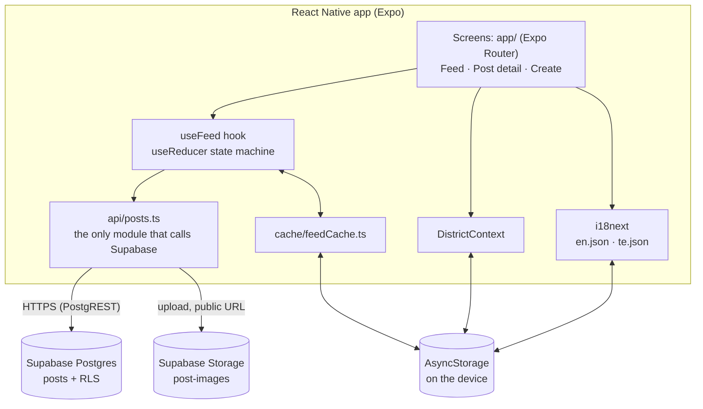

# Ooru · ఊరు

**A hyperlocal community app for Telugu speakers.** Browse local news and classified ads for your district in Telugu or English, and post your own classified ad with a photo. It works offline with the last feed you loaded.

Built with React Native + Expo (Expo Router, TypeScript), Supabase (Postgres + Storage), i18next, and Jest + React Native Testing Library.

> Ooru (ఊరు) means "hometown" or "village" in Telugu.

---

## Features

|                             |                                                                                                                                                                                                    |
| --------------------------- | -------------------------------------------------------------------------------------------------------------------------------------------------------------------------------------------------- |
| **District feed**           | Posts for Hyderabad, Vijayawada or Visakhapatnam. All / News / Classifieds tabs, pull-to-refresh, infinite scroll, and loading, empty and error states.                                            |
| **Remembers your district** | Your district is saved and restored on the next launch.                                                                                                                                            |
| **Post detail**             | Full post with photo, price in Indian format (₹1,35,000), district and relative time. Opens from a deep link (`ooru://post/<id>`) too.                                                             |
| **Post a classified**       | Title, description, price, district, display name and an optional photo from the camera or gallery. Validation messages appear next to each field; the photo goes to Supabase Storage. No sign-up. |
| **Telugu ⇄ English**        | Every screen in both languages. Defaults to the phone's language, and the header toggle switches instantly and is remembered. Telugu renders in **Noto Sans Telugu**.                              |
| **Offline**                 | The last feed per district + tab is saved on the device. With no connection you see it with a "No connection: showing posts saved 5 min ago" banner.                                               |
| **Accessible**              | Every control has a screen-reader label and role, tabs announce which one is selected, errors are read out when they appear, and touch targets are at least 48 dp.                                 |

## Screenshots

<!-- Replace these placeholders: take screenshots on a phone (or `adb exec-out screencap -p > feed.png`),
     put them in docs/screenshots/, and swap the cells below for . -->

|      Feed (English)      |      Feed (Telugu)       |       Post detail        |        Post an ad        |         Offline          |
| :----------------------: | :----------------------: | :----------------------: | :----------------------: | :----------------------: |
| _screenshot coming soon_ | _screenshot coming soon_ | _screenshot coming soon_ | _screenshot coming soon_ | _screenshot coming soon_ |

**Demo GIF:** _coming soon_ (`docs/demo.gif`: switch language → change district → post an ad → go offline).

## Download the APK

**[⬇ Download the latest Android APK](https://github.com/Smoothy123/ooru/releases/latest)** from GitHub Releases.

To install, open the file on an Android phone and allow "Install unknown apps" for your browser or file manager when asked.

---

## Run it locally

### 1. Prerequisites

- Node.js **22.13+** (the repo has an `.nvmrc`: run `nvm use`)
- The **Expo Go** app on an Android phone (Play Store), or an Android emulator
- A free **Supabase** account

### 2. Set up Supabase (about 5 minutes)

1. Create a new project at [supabase.com](https://supabase.com) (the free tier is enough).
2. Open **SQL Editor → New query**, paste [`supabase/schema.sql`](supabase/schema.sql) and click **Run**. This creates the `posts` table, indexes, row-level-security policies and the `post-images` storage bucket.
3. Run [`supabase/seed.sql`](supabase/seed.sql) the same way to add 21 sample posts in Telugu and English.
4. Go to **Project Settings → API** and copy the **Project URL** and the **anon / publishable key**.

### 3. Configure and start the app

```bash
git clone https://github.com/Smoothy123/ooru.git
cd ooru
npm install
cp .env.example .env        # then paste your Supabase URL and key into .env
npx expo start
```

Scan the QR code with Expo Go. `.env` is git-ignored; only `.env.example` (with placeholders) is committed.

### Scripts

| Command                 | What it does                                                         |
| ----------------------- | -------------------------------------------------------------------- |
| `npm start`             | Start the Expo dev server                                            |
| `npm test`              | Run the Jest test suites                                             |
| `npm run test:coverage` | Tests with a coverage report                                         |
| `npm run lint`          | ESLint (Expo config)                                                 |
| `npm run typecheck`     | TypeScript, no emit                                                  |
| `npm run format`        | Prettier                                                             |
| `npm run check`         | Lint + format check + typecheck + tests (run this before committing) |

### Build the APK yourself (EAS Build)

The APK is built in Expo's cloud, so you don't need Android Studio.

```bash
npm install -g eas-cli
eas login                    # free Expo account
eas init                     # links the project (adds extra.eas.projectId to app.json)

# .env is never uploaded, so give the build its values as EAS environment variables:
eas env:create --environment preview --name EXPO_PUBLIC_SUPABASE_URL --value "https://<ref>.supabase.co" --visibility sensitive
eas env:create --environment preview --name EXPO_PUBLIC_SUPABASE_ANON_KEY --value "<anon-key>" --visibility sensitive

eas build --platform android --profile preview
```

The `preview` profile in [`eas.json`](eas.json) produces an installable `.apk`; `production` produces an `.aab` for the Play Store.

---

## Architecture



**Data flow for the feed:** the screen asks `useFeed(district, filter)` for posts → the hook calls `fetchPosts()` → on success it shows the page and saves page 1 to the cache → on failure it shows the saved page with the offline banner (or the error state if nothing is saved).

```
app/                        Expo Router: one file = one screen
├── _layout.tsx             Root stack, font + saved-language loading, error boundary
├── index.tsx               Feed
├── post/[id].tsx           Post detail
└── create.tsx              Post a classified (modal)
src/
├── api/posts.ts            Typed Supabase calls: fetchPosts, fetchPostById, createClassified, uploadPostImage
├── lib/supabase.ts         Supabase client from EXPO_PUBLIC_* env vars
├── hooks/useFeed.ts        Feed state: pages, refresh, load more, offline fallback
├── cache/feedCache.ts      AsyncStorage snapshot of each feed's first page
├── context/DistrictContext.tsx   Selected district, saved across launches
├── validation/classified.ts      Pure form validation → i18n error keys
├── i18n/                   i18next setup, en.json, te.json
├── components/             Presentational: PostCard, FilterTabs, DistrictPicker, FormField, …
├── constants/ types/ utils/ mocks/
supabase/
├── schema.sql              Table, indexes, RLS, column grants, storage bucket
└── seed.sql                21 sample posts (Telugu + English)
__tests__/                  Jest + React Native Testing Library
```

## Key decisions

### Why Expo?

The app needs camera and gallery access, local storage, fonts and localisation, and Expo has a maintained module for each of these, so there's no native code to write or upgrade. **Expo Router** gives file-based navigation and deep links for free. **EAS Build** produces the APK in the cloud, so the project builds on any laptop without Android Studio. Permissions are declared in `app.json` through config plugins instead of editing `AndroidManifest.xml`. The APK asks only for internet and camera (plus photo storage on Android 12 and older). Microphone, "display over other apps" and vibrate, which the template would otherwise include, are removed. If the app ever needs custom native code, Expo supports that through development builds and config plugins.

### How the offline cache works

- **Network first, cache as fallback.** Every successful load of page 1 is saved to AsyncStorage under `ooru:feed:v1:<district>:<filter>`, along with the time it was saved.
- If a request fails (no signal, dead Wi-Fi, server down), `useFeed` reads that snapshot and shows it with a banner. With nothing saved, it shows an error with **Try again**. Pull-to-refresh retries the network.
- **Requests time out after 10 s.** React Native's `fetch` never gives up on its own, so without a timeout a phone on Wi-Fi with no internet would spin forever instead of falling back.
- **Small and bounded.** At most 9 keys (3 districts × 3 tabs) of about 10 posts each. Only page 1 is saved, because that's what a user opening the app offline needs.
- The **detail screen** looks for the post in the saved feeds when it can't reach the server.
- **Versioned keys.** If the `Post` shape changes, bumping `v1` makes the app ignore old snapshots instead of rendering bad data.
- I don't use NetInfo: a failed request is the most reliable "offline" signal, and it also covers "connected to Wi-Fi with no internet".

### How the feed would scale to millions of posts

- **Keyset (cursor) pagination, not `OFFSET`.** Each page asks for "posts older than the last one I showed", using `(created_at, id)` with the id as a tie-breaker. `OFFSET 100000` makes Postgres read and throw away 100,000 rows; a cursor jumps straight to the right place in the index. A cursor also never shows duplicates or skips posts when new ones arrive while you scroll.
- **Indexes that match the queries exactly:** `(district, created_at desc, id desc)` for _All_ and `(district, type, created_at desc, id desc)` for the tabs. I checked with `EXPLAIN` that the cursor condition is an _Index Cond_: the query adds a redundant `created_at <= cursor` filter so Postgres can start the scan at the cursor. Every page costs the same, however deep you scroll.
- **Page size + 1.** The API asks for 11 rows to show 10, so it knows whether there's a next page without a `COUNT(*)`, which would be slow on a big table.
- **Only the needed columns** are selected, and images are served from Storage's CDN, not the database.
- **Client side:** stable keys, `React.memo` cards and stable callbacks mean appending a page doesn't re-render existing cards. The next steps would be [FlashList](https://shopify.github.io/flash-list/) for very long lists and resized thumbnails (Supabase image transformations) instead of full photos.
- **Beyond that:** partition `posts` by district (or by month), add a read replica for the read-heavy feed, put a short CDN/edge cache in front of page 1 per district, and move inserts behind an Edge Function with rate limiting and moderation.

### Other decisions

- **No state library.** The only state shared between screens is the selected district, so a small React Context is enough. Feed state lives in one `useReducer`, which puts every transition (loading, refreshing, loading more, offline, error) in one pure function. In a production app I'd consider TanStack Query, which gives caching and retries out of the box; writing it by hand here shows what such a library does.
- **"Latest request wins".** Each feed request gets a number and late responses from an old filter or district are ignored. Without this, quickly tapping _All → News_ could show the _All_ results under the _News_ tab.
- **Fonts follow the text, not the UI language.** A Telugu ad can appear while the app is in English, so `AppText` switches to Noto Sans Telugu whenever a string contains Telugu characters (U+0C00–U+0C7F). It picks the bold _file_ for bold text instead of letting Android fake-bold the regular one. It also raises line height to 1.6× so vowel signs and vattulu aren't clipped. Only the two weights used are bundled (360 KB instead of 1.6 MB).
- **Districts are stored as slugs** (`hyderabad`) and translated only for display, so the data doesn't depend on the UI language.
- **Validation is a pure function** that returns translation keys. It's trivial to unit-test, it works in both languages, and it's slightly stricter than the database `CHECK` constraints, so a well-behaved client never hits them.
- **The API layer is the boundary.** Screens get camelCase `Post` objects; only `api/posts.ts` knows the database column names.

### Security model (no login)

The Supabase anon key ships inside the APK (all `EXPO_PUBLIC_*` values do), so **anyone can call the API directly**. The database itself enforces what's allowed:

- **Row-level security:** anyone can read posts. Anyone can insert, but only `type = 'classified'` with a price and a photo URL from this project's bucket, so the public can't publish "news" or link arbitrary images. There are no update or delete policies, so nobody can edit or remove posts.
- **Column grants:** the public can insert only content columns. `id` and `created_at` always come from the server, so nobody can back-date a post or pin it to the top with a future timestamp.
- **Storage:** a public-read bucket that accepts uploads only, of images up to 5 MB.
- **Known gap:** without accounts, spam is possible. The next steps would be Supabase Auth (anonymous or phone OTP), a rate-limited Edge Function for posting, and a moderation flag.

All of these rules were tested against a local Postgres using the `anon` role.

## Testing

```bash
npm test                 # 8 suites, 67 tests
npm run test:coverage
```

| Suite                    | What it proves                                                                                                                                                   |
| ------------------------ | ---------------------------------------------------------------------------------------------------------------------------------------------------------------- |
| `FeedScreen.test.tsx`    | Renders posts (Telugu included), filter tabs, district switch is saved and restored, empty state, navigation, offline banner with saved posts, error + Try again |
| `useFeed.test.ts`        | Cursor pagination, one request even if `onEndReached` fires twice, stale responses ignored, page 1 cached, offline fallback                                      |
| `CreateScreen.test.tsx`  | Errors only after the first submit, live updates, price format, exact payload sent, failure keeps the form                                                       |
| `validation.test.ts`     | Every rule, including Telugu text, Indian-style commas in prices and photo size                                                                                  |
| `offlineDetail.test.tsx` | Cache round-trip, corrupted entries, detail screen's saved-copy fallback                                                                                         |
| `api.test.ts`            | Query shape (page size + 1, cursor filter), snake_case → camelCase mapping, errors                                                                               |
| `i18n.test.tsx`          | Telugu has every English key with the same `{{placeholders}}`, language choice persists, Telugu font selection                                                   |
| `format.test.ts`         | Indian number grouping, relative time                                                                                                                            |

Only the network layer and the router are mocked in screen tests. Hooks, cache, context, components and translations run for real. To check that the tests actually catch bugs, I removed the stale-response guard, the double-fetch guard, the offline fallback, the price check and the district persistence one at a time. Each change made at least one test fail.

## License

MIT
